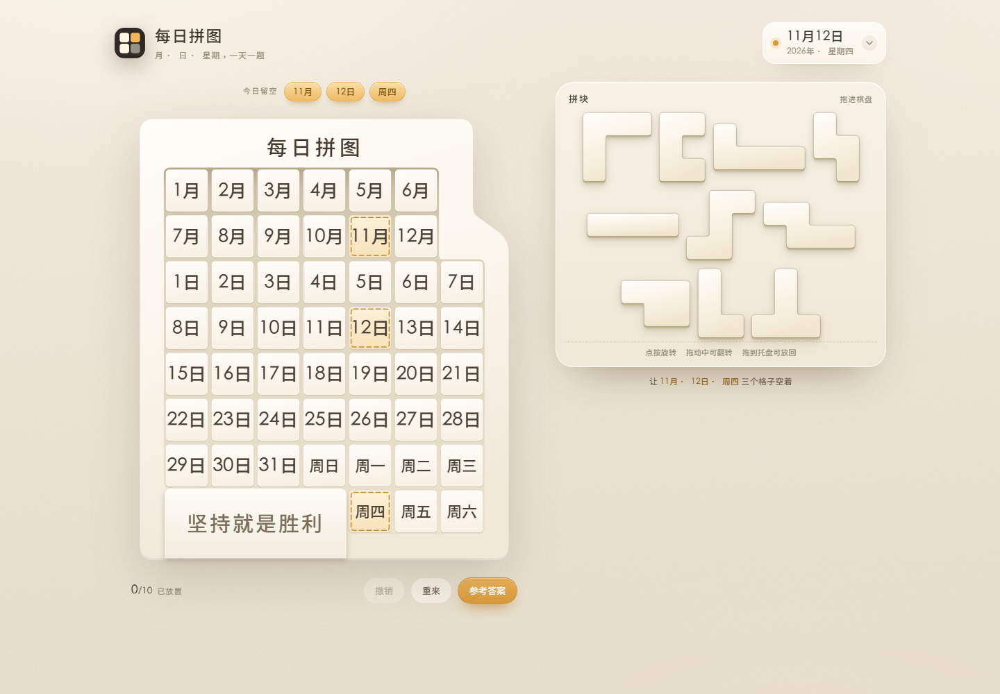
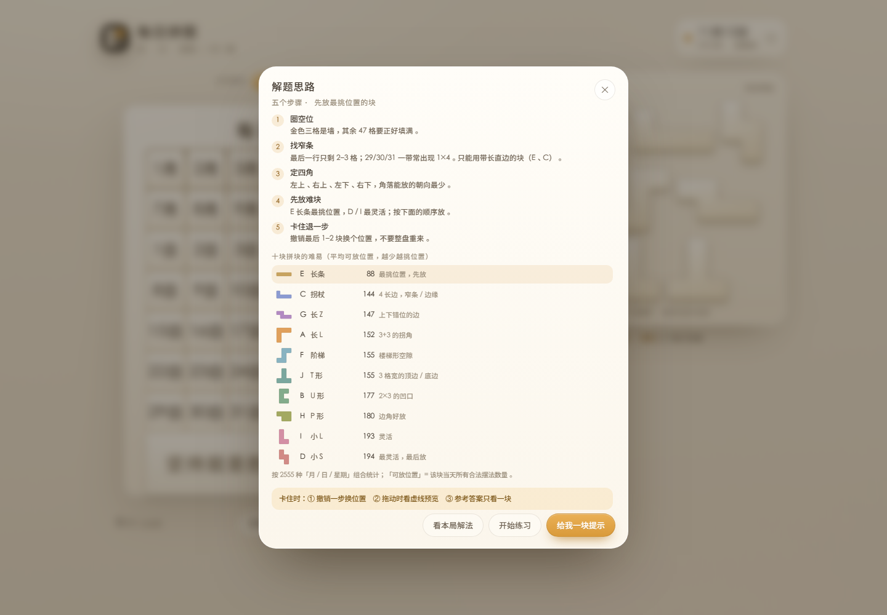
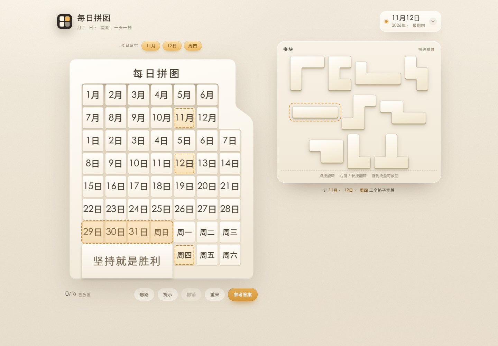
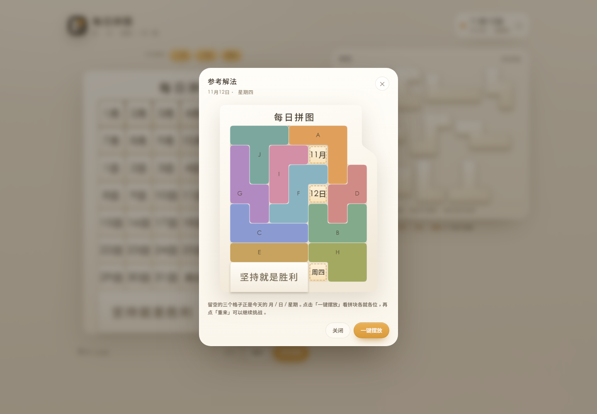
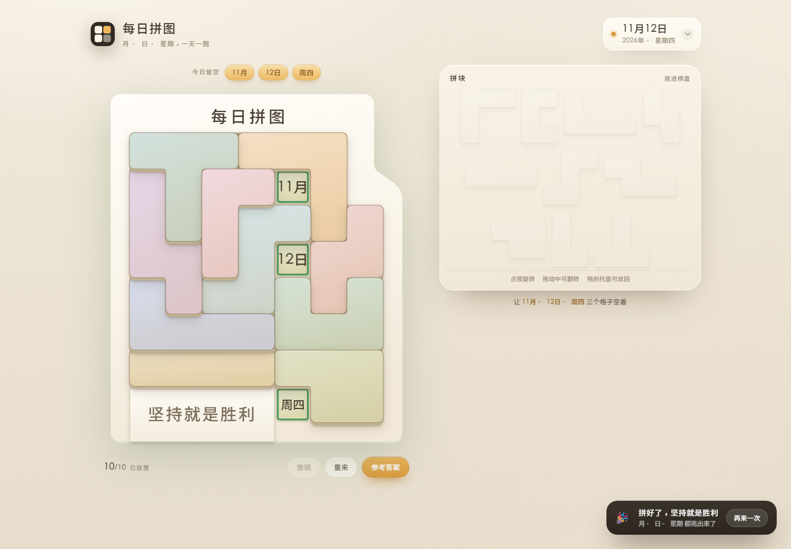
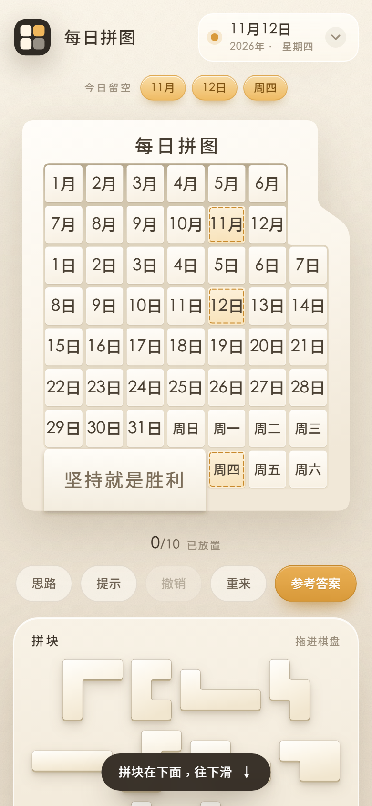

<div align="center">

# 🧩 每日拼图

**用 10 块拼块盖住棋盘，只留下今天的「月 · 日 · 星期」**

[🎮 立即试玩](https://fzn1982.github.io/daily-puzzle/)　·　[📖 解题思路](解法思路.md)　·　[📱 手机怎么玩](#-手机上怎么玩)



</div>

---

## 📖 这是什么

把实物 3D 打印的「每日拼图」做成了网页版：棋盘上印着 12 个月、31 天、7 个星期，每天要留下 **月 / 日 / 星期** 三个格子空着，其余 47 格由 10 块拼块严丝合缝地填满。

- 棋盘：7 列 × 8 行，共 **50 个可放置格**（上两行各 6 格是月份，第 3–7 行各 7 格是日期 + 周日–周三，最后一行只有 3 格是周四–周六）；
- 拼块：**10 块、共 47 格**，按照片逐格还原；
- 每天留下 3 格，正好拼出当天的日期。

## ✨ 功能

| | |
| --- | --- |
| 📅 **每天自动换题** | 按设备本地日期出题，0 点自动切换 |
| 🗓️ **任意日期** | 点右上角日期即可换天，前后翻 / 选日期 / 随机一天 / 回今天 |
| 🖱️ **拖拽 + 磁吸** | 靠近合法位置自动吸附，落位前有虚线预览 |
| 🔄 **旋转 / 翻转** | 点按旋转；右键 / 长按 / `F` / `R` / 滚轮翻转旋转 |
| 💡 **思路 + 提示** | 内置解题攻略；点「提示」每次只帮你标出一块的位置，且兼容你已摆好的拼块 |
| 🧠 **参考解法** | 完整解法图，可「一键摆放」看拼块各就各位 |
| 💾 **进度保存** | 每个日期独立保存在浏览器本地，刷新、换日期再换回来都不丢 |
| 📱 **手机友好** | 响应式布局、触屏拖拽、手机端引导提示 |

## 📸 截图

| 解题思路 | 逐块提示 |
| --- | --- |
|  |  |

| 参考解法 | 拼好之后 |
| --- | --- |
|  |  |

## 🎮 怎么玩

1. 顶部是今天的日期，棋盘上 **金色三格** 就是今天要留空的「月 / 日 / 星期」；
2. 把右侧托盘里的拼块拖到棋盘，靠近正确位置会自动吸附；
3. 点按拼块旋转，右键 / 长按翻转（拖动中也可以按 `F` 翻转、按 `R` 或滚轮旋转）；
4. 10 块全部放好、只剩那三个金色格子时，就赢了；
5. 卡住了可以 `撤销`、`思路`、`提示`，或直接看 `参考答案`。

> 小技巧：先放「最挑位置」的块 —— E 长条（平均只有 88 种摆法）→ C → G → A → F → J → B → H → I → D（最灵活的 D 平均有 194 种）。详见 [解法思路.md](解法思路.md)。

## 📱 手机上怎么玩

手机上页面是纵向排布：**上面是棋盘，拼块托盘在下面**。

- 如果打开只看到日历盘，说明拼块在下面 —— **往下滑**就能看到；
- 首次打开时，屏幕底部会出现「**拼块在下面，往下滑 ↓**」的提示，点一下会直接跳到拼块区；
- 把拼块从托盘拖到棋盘上即可，靠近正确位置会自动吸附；
- 点按拼块旋转，长按拼块翻转。

<p align="center">
  
</p>

## 🧠 关于求解器

- 纯前端实现：位掩码 + 回溯，每一步优先选「可选摆法最少」的格子，毫秒级出解；
- 支持 **固定已放好的拼块** 再解剩余部分，所以「提示」永远和你当前的进度一致；
- 已用脚本穷举验证：全部 **2555 种真实「月 / 日 / 星期」组合** 都有解（允许旋转与翻转），最慢一例 < 1 秒；
- 解法数据与游戏共用同一份 `solver.js`，浏览器和 Node 都能直接跑。

## 🗂️ 目录结构

```
.
├── index.html          # 页面结构 + 内联 SVG 资源
├── styles.css          # 全部样式与响应式布局
├── app.js              # 拖拽吸附、旋转翻转、存档、思路、提示
├── solver.js           # 拼块数据 + 回溯求解器（浏览器 / Node 通用）
├── 解法思路.md          # 完整的解题思路与示例
├── preview/            # 截图
└── 每日拼图-部署包.zip   # 单文件版 + 分享卡片，可直接拖去静态托管
```

## 🚀 本地运行

```bash
# 在仓库根目录
python -m http.server 8000
# 打开 http://127.0.0.1:8000
```

也可以直接双击 `index.html`（纯静态、零依赖，离线可用；个别浏览器对本地 `file://` 的 localStorage 有限制，用上面的方式最稳）。

## 🌐 部署

当前线上地址：**<https://fzn1982.github.io/daily-puzzle/>**（GitHub Pages）

- 更新：把改动的文件提交到 `main`，Pages 约 1 分钟后自动重新部署；
- 也可以把 `每日拼图-部署包.zip` 解压后拖到 [Netlify Drop](https://app.netlify.com/drop) 或 Cloudflare Pages，得到另一条备用线路；
- 单文件版只有 90 KB 左右，任何静态托管都能跑，不需要后端和数据库。

## 🧩 一点背景

拼块是根据实拍照片逐格还原的（原图见 [preview/original.jpg](preview/original.jpg)），棋盘左下角保留了实物上的「坚持就是胜利」铭牌，算是个小彩蛋。

纯原生 HTML / CSS / JavaScript，无框架、无依赖、无统计脚本。

---

<div align="center">

如果它让你每天多想了三分钟，欢迎点个 ⭐️

</div>
