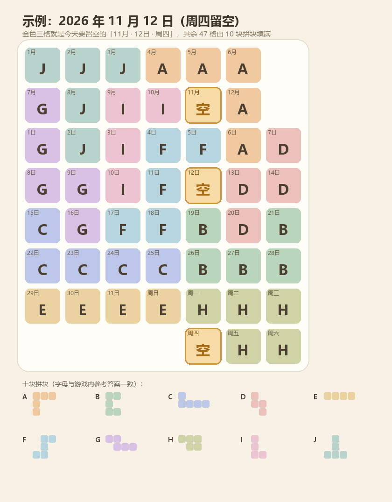

# 每日拼图 · 解法思路

> 这些内容已经内置到游戏里了：点棋盘下方的 **「思路」** 按钮随时查看；点 **「提示」** 会高亮一块的正确位置，照着摆就行，点一次给一块，适合练习。

先说结论：这个游戏**不是靠“聪明”**，而是靠**找窄条**和**先放最挑位置的块**。
50 个格子只空 3 格，等于几乎没有多余空间——一块放错，最后就会差一格塞不进去，所以很多日期只有唯一解，卡住很正常。

---

## 一、先看清棋盘长什么样

| 区域 | 格子 |
| --- | --- |
| 上面两行 | 各 6 格，是 1–6 月、7–12 月 |
| 中间五行 | 各 7 格，是 1–31 日 + 周日–周三 |
| 最后一行 | 只有第 5–7 列，是 周四 / 周五 / 周六 |
| 左下 | 「坚持就是胜利」铭牌，不能放 |

每天要留空的 3 格（月、日、周几）就是**墙**。它们把棋盘切成几个形状，先盯着这些形状看。

---

## 二、通用五步

1. **圈出 3 个空位**（游戏里已经用金色高亮）。
2. **找窄条**：最后一行只剩 2–3 格、29/30/31 一带常出现 1×4 的长条。这些地方只能由“带长直边”的块来填（E 长条、C 的 4 格边）。
3. **看四个角**：左上、右上、左下、右下。角落里能放的朝向少，先定下来。
4. **先放“挑位置”的块**，再放灵活的块（见下面的表）。把难放的块留到最后，往往会发现没地方了。
5. **卡住就退最后 1–2 块**，不要全部重来。游戏里的“撤销”正好干这个。

---

## 三、哪块难放？一张表（2555 种日期统计）

“可放位置”是这个块在当天棋盘上所有合法摆法的数量，越少越挑位置：

| 块 | 形状 | 平均可放位置 | 性格 |
| --- | --- | --- | --- |
| **E** | `####` | **88** | 唯一 4 格直条，最挑位置，**第一优先放** |
| C | `#.../####` | 144 | 长边 4，适合窄条和边缘 |
| G | `##../.###` | 147 | 长 Z，适合上下错位的边 |
| A | `###/#../#..` | 152 | 长 L，需要 3+3 的拐角 |
| F | `.##/.#./##.` | 155 | 阶梯，适合楼梯形空隙 |
| J | `.#./.#./###` | 155 | T 形，适合 3 格宽的顶边/底边 |
| B | `##/#./##` | 177 | U 形，需要 2×3 的凹口 |
| H | `###/.##` | 180 | P 形，天生适合边角 |
| I | `#./#./##` | 193 | 小 L，灵活 |
| D | `#./##/.#` | 194 | 小 S，最灵活，最后放 |

> 经验顺序：**E → C → G → A → F → J → B → H → I → D**。
> 先放 E，是因为它只有 74–100 种摆法，而 I / D 有 160 种以上；把 E 留到最后，十有八九会“没地方”。

---

## 四、今天这局怎么走（2026-11-12，周四留空）

空位是 11月、12日、周四。可以按这个顺序：

1. **右下角先解决**：周四留空后，最下面只剩 周五、周六 两格；它们必须和上面一行连起来。**H（P 形）** 正好盖住 周一、周二、周三 + 周五、周六，右下角一下就平了。
2. **左下 1×4 窄条**：29日、30日、31日、周日 是 4 个连续格，**E（长条）** 正好放进去。
3. **左边缘**：**C** 盖 15日 + 22/23/24/25日，把左下角封住。
4. **左上角**：**J（T 形）** 的 3 格横条放在第一行，盖 1月、2月、3月 + 8月 + 2日。
5. **左中**：**G** 沿左边缘盖 7月、1日、8日、9日、16日。
6. **右上**：**A** 盖 4月、5月、6月 + 12月 + 6日。
7. **右边**：**D** 贴右边缘盖 7日、13日、14日、20日。
8. **中间**：**B** 盖 19日、21日、26日、27日、28日。
9. **剩下两处**：**F** 盖 4日、5日、11日、17日、18日；**I** 盖 9月、10月、3日、10日。

对照图里的字母看一遍，再回到游戏里自己摆一次，会很快有感觉。

---

## 五、卡住时的三个“救命”操作

1. **退一步，不要重开**：撤销只拿掉最后一块，换一个位置往往就通了。
2. **看虚线预览**：拖动时如果出现虚线，说明那里放得下；没有虚线就是放不下（重叠或越界），不用硬试。
3. **参考答案当“提示”用**：打开答案，只看 1–2 块的位置，记住后关掉，自己继续。比一次看完更有用。

---

## 六、练习路线（三四天就能明显变快）

- 第 1–2 天：照着参考答案摆，边摆边念“E 在窄条、H 在右下、J 在顶边”。
- 第 3–4 天：答案只看 3 块，剩下自己补。
- 之后：先自己摆到 7–8 块，卡住再看答案；重点记“这块为什么只能放这”。
- 每天的空位不同，但**窄条、边角、2×3 凹口**这几种地形会反复出现。

---

## 七、常见误区

- **从中间开始摆**：中间最灵活，先摆中间，边角最后往往塞不进去。
- **把长条 E 留到最后**：它最挑位置，越晚越难放。
- **放错就全部重来**：其实只要退 1–2 块。
- **盯着整盘看**：先看最窄的一行/一列，答案通常就在那里。
